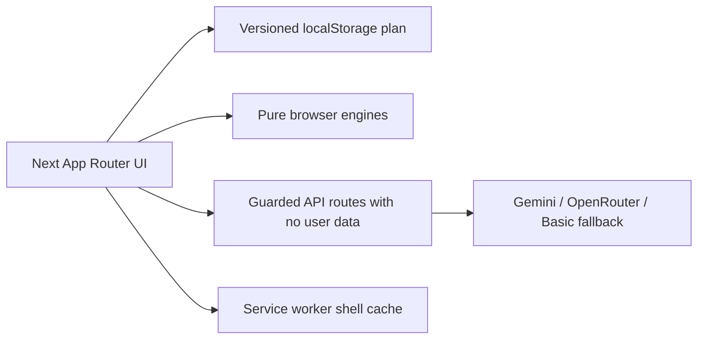

# Gatherly

[](https://github.com/ogMaverick12/gatherly/actions/workflows/ci.yml)

Gatherly is a calm, global event-planning companion for weddings, birthdays and community
gatherings. It turns budgets, dates, vendor questions, contingencies and the "what should we do
next?" feeling into one warm workspace.

Everything that decides a number - budget allocation, backward milestones, vendor coverage, the
health score, risks, the run-of-show, catering estimates - is computed **in the browser** from the
answers you give. AI is optional, isolated behind guarded routes, and clearly labelled when it is
in use. Without a network, or without an API key, the plan still works.

---

## Chosen vertical

**Challenge 5: Celebration & Event Planner.** Gatherly is designed around one persona: a person
organising a wedding, a birthday or a community gathering who has a date, a guest list and a budget
but no planning experience. Every screen answers the same question for that person: "what should we
do next?"

## Approach and logic

The plan is **derived from the user's context**, not typed in by hand. Event type, date, guest count,
city tier, venue type, currency, priorities, and dietary and access needs feed a set of small,
pure, deterministic engines. Each decision follows a visible rule:

| Decision            | The rule                                                                                                                                                    |
| ------------------- | ----------------------------------------------------------------------------------------------------------------------------------------------------------- |
| Budget              | Benchmark shares per event type, adjusted for city tier, venue and priorities, in whole minor units with largest-remainder rounding, plus an 8% contingency |
| Timeline            | Milestones worked backwards from the event date, each with an owner, a date and the reason it matters                                                       |
| Vendors             | A checklist per category; coverage is booked and quoted spend against the planned allocation                                                                |
| Health score        | Five weighted parts (budget, timeline, vendors, tasks, guest experience) that sum to 100                                                                    |
| Risks, next action  | Rules over the same plan pick the risks worth showing and the one most useful next step                                                                     |
| Ideas and assistant | Grounded in the plan; a model (Gemini or OpenRouter) is an optional layer, and a labelled Basic mode answers deterministically when none is configured      |

## How the solution works

1. **Start.** The landing page offers three one-click sample plans, or the four-step intake.
2. **Intake.** Event type, date, guests, city tier, venue, currency, budget, priorities and needs.
   Every field is validated with Zod, and the review step shows exactly what will be used.
3. **Workspace.** The engines turn those answers into six tabs: overview, budget, timeline,
   vendors, ideas and an assistant. Editing anything (a quote, a task, the budget) recomputes the
   rest.
4. **Take it with you.** Print-to-PDF, an `.ics` calendar, a budget CSV and a share link.

The plan lives in the browser (a versioned `localStorage` entry). The server is stateless: guarded
API routes handle only the optional AI calls, and a badge always says whether an answer came from a
model or from Basic mode. See [Architecture at a glance](#architecture-at-a-glance) below.

## Assumptions

- **Numbers are estimates, not quotes.** They come from a model of a typical event, adjusted for
  what you entered. There is no market data; replace a figure with a real quote before relying on it.
- **City tier is a coarse band**, and the contingency is a flat percentage, not a risk calculation.
- **One person, one browser.** There are no accounts, no collaboration and no history; the JSON
  export and the share link are the only ways out.
- **Traditions are never inferred.** Tradition and festival packs apply only when you choose them,
  and they are starting points to confirm with family, elders or organisers.
- **AI is optional.** Without a key or a network the app works in Basic mode, and the health score
  is a weighted checklist, not a verdict.
- **Currency and language are your choice.** Amounts are held in minor units; app labels are
  available in English, Hindi and Bengali.

Fuller detail, including what the app is not good at, is in [`docs/LIMITATIONS.md`](docs/LIMITATIONS.md).

---

## How Gatherly meets the product promise

The product promise is _"a GenAI-powered planning assistant that helps users organize weddings,
birthdays and community events with budgets, timelines, vendor checklists and personalized ideas"_.
Each part of that sentence has a feature, a place in the code and a test that holds it up.

| The requirement         | Gatherly does it here                                                                                                                                              | The code                                                                                        | The tests                                                                                                                                                                                                    |
| ----------------------- | ------------------------------------------------------------------------------------------------------------------------------------------------------------------ | ----------------------------------------------------------------------------------------------- | ------------------------------------------------------------------------------------------------------------------------------------------------------------------------------------------------------------ |
| GenAI-powered assistant | A question box that answers from your plan, streamed, with a badge that says whether a model wrote it; a deterministic Basic mode when no key is set               | `src/lib/ai/`, `src/app/api/chat/route.ts`, `src/features/assistant/index.ts`                   | `tests/lib/ai/ai.test.ts`, `tests/app/api/chat-stream.test.ts`, `tests/features/workspace/assistant-stream.test.tsx`, `tests/lib/security/provider-retry-and-guards.test.ts`, `tests/app/api/routes.test.ts` |
| Weddings                | Wedding benchmarks, wedding idea set, wedding ceremony flow in the run-of-show                                                                                     | `src/features/budget/index.ts`, `src/features/ideas/index.ts`, `src/features/timeline/index.ts` | `tests/features/budget/budget.test.ts`, `tests/features/ideas/ideas.test.ts`, `tests/features/timeline/timeline.test.ts`                                                                                     |
| Birthdays               | Birthday benchmarks, birthday idea set, birthday run-of-show                                                                                                       | `src/features/budget/index.ts`, `src/features/ideas/index.ts`, `src/features/timeline/index.ts` | `tests/features/budget/budget.test.ts`, `tests/features/ideas/ideas.test.ts`, `tests/features/timeline/timeline.test.ts`                                                                                     |
| Community events        | Community gathering as a first-class event type, with its own benchmarks, ideas and preparation steps                                                              | `src/lib/plan`, `src/features/budget/index.ts`, `src/features/ideas/index.ts`                   | `tests/lib/plan/plan.test.ts`, `tests/features/ideas/ideas.test.ts`, `tests/features/budget/budget.test.ts`                                                                                                  |
| Budgets                 | Visible category maths in whole paise, an 8% contingency, per-guest figures, benchmark shares and what-if scenarios                                                | `src/features/budget/index.ts`, `src/lib/money.ts`                                              | `tests/features/budget/budget.test.ts`, `tests/lib/money.test.ts`, `tests/lib/property.test.ts`                                                                                                              |
| Timelines               | Milestones worked backwards from the event date, each with an owner, a date and a reason, plus a run-of-show                                                       | `src/features/timeline/index.ts`                                                                | `tests/features/timeline/timeline.test.ts`, `tests/lib/property.test.ts`                                                                                                                                     |
| Vendor checklists       | A category checklist with statuses, quotes and deposits, and a coverage percentage against the plan                                                                | `src/features/vendors/index.ts`                                                                 | `tests/features/vendors/vendors.test.ts`, `tests/features/vendors/vendors-panel.test.tsx`                                                                                                                    |
| Personalized ideas      | Ideas computed from your guests, city tier, priorities and dietary needs, each with the reasoning shown, and a model-written variant when a provider is configured | `src/features/ideas/index.ts`, `src/app/api/ideas/route.ts`                                     | `tests/features/ideas/ideas.test.ts`, `tests/app/api/routes.test.ts`                                                                                                                                         |

---

## Quick start

```bash
npm install
cp .env.example .env.local     # optional: Basic mode works with no keys at all
npm run dev
```

Open <http://localhost:3000>. The landing page has three one-click sample plans - a wedding, a
birthday and a community gathering - so you can see the workspace in under a minute.

### Scripts

| Script                  | What it does                                              |
| ----------------------- | --------------------------------------------------------- |
| `npm run dev`           | Next.js dev server                                        |
| `npm run build`         | Production build                                          |
| `npm start`             | Serve the production build                                |
| `npm run lint`          | ESLint 9, flat config, `--max-warnings=0`                 |
| `npm run typecheck`     | `tsc --noEmit`, strict mode                               |
| `npm run format:check`  | Prettier, check only                                      |
| `npm test`              | Vitest, the unit and component suites                     |
| `npm run test:coverage` | Vitest with the v8 coverage report and thresholds         |
| `npm run knip`          | Finds unused files, exports and dependencies              |
| `npm run check`         | lint + typecheck + format check + coverage + Knip + stats |
| `npm run test:e2e`      | Playwright journeys (`npm run e2e:install` first, once)   |
| `npm run stats`         | Prints the shape lists and allowance checks               |

### Environment

All variables are read **on the server only**; there is deliberately no `NEXT_PUBLIC_` variant.

| Variable                                              | Default                   | Purpose                                  |
| ----------------------------------------------------- | ------------------------- | ---------------------------------------- |
| `GATHERLY_AI_PROVIDER`                                | `basic`                   | `basic`, `gemini` or `openrouter`        |
| `GEMINI_API_KEY`                                      | -                         | Server-only key for Google Gemini        |
| `OPENROUTER_API_KEY`                                  | -                         | Server-only key for OpenRouter           |
| `GATHERLY_GEMINI_MODEL`                               | `gemini-3.6-flash`        | Model id (2.0 ids were retired)          |
| `GATHERLY_OPENROUTER_MODEL`                           | `google/gemini-3.8-flash` | Model id                                 |
| `UPSTASH_REDIS_REST_URL` / `UPSTASH_REDIS_REST_TOKEN` | -                         | Shared-store rate limiting in production |

**Rate limiting in production:** the shared Upstash store is the production configuration, and the
in-process bucket is the local default. The live mode is never assumed - `GET /api/health` answers
`{ ok, mode, rateLimit }`, where `rateLimit` is `shared` or `per-instance`. A production start
without the variables logs one warning naming them. The limits themselves are unchanged, so a
deployment that has not set them still serves the demo at the documented rate.

`basic` is the default **and** the fallback. If a provider is selected but has no key, or the call
fails or times out, the route answers deterministically and says so in the UI.

**What switches the AI on:** set `GATHERLY_AI_PROVIDER` to `gemini` or `openrouter` and set the
matching key (`GEMINI_API_KEY` or `OPENROUTER_API_KEY`). Without both, the app is in Basic mode:
the same routes, the same screens, the same buttons, with deterministic answers and a visible
badge that says **Basic mode** instead of **AI assisted**. Which mode a deployment runs in, and
what was actually verified, is recorded in
[`docs/LIVE_VERIFICATION.md`](docs/LIVE_VERIFICATION.md).

In Basic mode **nothing goes to a third party**: no provider is contacted and no key is needed.
The ideas, chat and parse requests still reach this app's own server, which answers them from
deterministic rules over the plan that was sent. The full plan stays in the browser; the route
receives only the summary needed to answer.

---

## What is in the product

**Landing** - editorial split hero, the three event families, what the product does, one-click
sample plans for all three, and the honest privacy line: the plan lives in your browser.

**Intake** - four steps (basics, money, needs, extras) covering event type, date, guest count,
city tier, venue type, currency and budget, priorities, dietary and access needs, a free-text
culture note, notes, language, and optional tradition/festival packs. Every field is validated
with Zod; the review step shows exactly what will be used.

**Workspace** - six tabs:

- **Overview** - health ring, risks, run-of-show, next action.
- **Budget** - visible category math, per-guest figures, what-if scenarios for more/fewer guests.
- **Timeline** - milestones computed backwards from the event date, each with an owner and a date.
- **Vendors** - checklist with status, quotes, a coverage percentage, and a WhatsApp-ready message.
- **Ideas** - deterministic Basic-mode suggestions with the mode badge always visible.
- **Assistant** - ask a question; the answer is streamed, and the mode badge tells you where it
  came from.

**Exports** - print-to-PDF, an `.ics` calendar file, a budget CSV, and a shareable URL fragment.

**Accessibility and display** - skip link, visible focus rings, 44px targets, three text sizes,
light/dark/system themes, Calm mode, reduced motion, and English, Hindi and Bengali app labels.

---

## Architecture at a glance



The server stores no plan or user data. The plan belongs to the browser; share links use a URL
_fragment_, which browsers do not send in HTTP requests, so a share creates no server state. AI
requests send only the bounded summary the route needs; a configured provider receives that summary
and the user's prompt. The deterministic engines are pure functions with no network access, so the
product keeps working with the network switched off.

Full detail: [`docs/ARCHITECTURE.md`](docs/ARCHITECTURE.md).

---

## Project layout

```text
src/app/                  App Router pages, error boundaries and API routes
  api/chat|ideas|parse     guarded AI handlers
  api/health              deployment mode and rate-limit mode
src/components/ui/        shared primitives: Button, ButtonLink, Card, Chip, SectionLabel, StatRow
src/features/             domain slices, each public through index.ts
                          budget, timeline, vendors, health, catering, risks, ideas,
                          assistant, intake, workspace, accessibility
src/lib/                  shared plan schema and store, money, dates, exports and utilities
  plan/                   schemas, samples, packs, currencies and taxonomy
  ai/                     provider selection, Basic/Gemini/OpenRouter adapters and prompts
  security/               route factory, guards, rate limiting, sanitising and the redacting logger
  i18n/                   en, hi and bn dictionaries
src/instrumentation.ts    startup hook: one warning if the shared rate limiter is unconfigured
tests/                    Vitest suites, shared support and fixtures
  e2e/                    Playwright journeys and accessibility sweeps
scripts/                  stats, bundle checks, screenshots, live smoke and service-worker stamping
docs/                     architecture, traceability, tour, limitations, outcomes and live verification
public/                   manifest, icons and the shell-cache service worker
```

---

## Why each dependency

Every package in `dependencies` and `devDependencies`, with the reason it is here. A dependency
without a row is a dependency that should not be in `package.json`.

| Package                             | Scope   | Why it is here                                                                                     |
| ----------------------------------- | ------- | -------------------------------------------------------------------------------------------------- |
| `@google/genai`                     | runtime | SDK behind the optional Gemini provider (`src/lib/ai/gemini.ts`).                                  |
| `@hookform/resolvers`               | runtime | `zodResolver` so the intake form validates with the same Zod schema the plan uses.                 |
| `next`                              | runtime | App Router framework: pages, metadata, streaming API handlers and static serving.                  |
| `react`                             | runtime | UI runtime for the client workspace components.                                                    |
| `react-dom`                         | runtime | The DOM renderer React needs in the browser.                                                       |
| `react-hook-form`                   | runtime | Intake form state, field errors and per-step validation.                                           |
| `zod`                               | runtime | Single source of truth for the plan, API payload and LLM output schemas.                           |
| `@axe-core/playwright`              | dev     | axe accessibility sweeps inside the Playwright journeys.                                           |
| `@eslint/eslintrc`                  | dev     | `FlatCompat`, which loads the Next.js legacy config under ESLint 9.                                |
| `@playwright/test`                  | dev     | The end-to-end journeys (`npm run test:e2e`).                                                      |
| `@testing-library/jest-dom`         | dev     | DOM matchers, imported once in `tests/support/setup.ts`.                                           |
| `@testing-library/react`            | dev     | Renders components into jsdom for the component suite.                                             |
| `@testing-library/user-event`       | dev     | User-like typing, clicking and focus moves in component tests.                                     |
| `@types/node`                       | dev     | Node typings for the Next.js config, the Playwright config and the scripts.                        |
| `@types/react`                      | dev     | React typings for strict `tsc --noEmit`.                                                           |
| `@types/react-dom`                  | dev     | React DOM typings for strict `tsc --noEmit`.                                                       |
| `@vitest/coverage-v8`               | dev     | The v8 coverage provider that enforces the per-area thresholds.                                    |
| `autoprefixer`                      | dev     | Loaded by `postcss.config.mjs` to add vendor prefixes to the CSS output.                           |
| `eslint`                            | dev     | The lint gate (`eslint . --max-warnings=0`).                                                       |
| `eslint-config-next`                | dev     | Loaded by `eslint.config.mjs` through `compat.extends('next/core-web-vitals', 'next/typescript')`. |
| `eslint-import-resolver-typescript` | dev     | Loaded by `eslint.config.mjs`; resolves `@/` imports so `import/no-cycle` can see them.            |
| `eslint-plugin-import`              | dev     | Supplies `import/no-cycle`, `no-duplicates` and `no-self-import`.                                  |
| `eslint-plugin-jsx-a11y`            | dev     | Loaded by `eslint.config.mjs` via `plugin:jsx-a11y/recommended`.                                   |
| `eslint-plugin-vitest`              | dev     | `vitest/no-focused-tests` and `no-identical-title`, so a focused test cannot ship.                 |
| `fast-check`                        | dev     | Property tests for money rounding and allocator invariants.                                        |
| `jest-axe`                          | dev     | axe assertions inside the component accessibility tests.                                           |
| `jsdom`                             | dev     | The browser environment the Vitest component suite runs in.                                        |
| `knip`                              | dev     | Finds unused files, exports and dependencies; `npm run check` fails when it finds dead code.       |
| `postcss`                           | dev     | The CSS plugin host named by `postcss.config.mjs`; the `overrides.postcss` entry pins it.          |
| `prettier`                          | dev     | The `format:check` gate and formatting that matches editors.                                       |
| `tailwindcss`                       | dev     | Utility CSS loaded by `postcss.config.mjs` and themed in `tailwind.config.ts`.                     |
| `typescript`                        | dev     | Strict typecheck via `tsc --noEmit`.                                                               |
| `vitest`                            | dev     | The unit and component runner and the coverage gate.                                               |

---

## Verification

Run these commands for the current measurements. Counts are printed by the command, not copied
here.

| Check                        | What it proves                                               |
| ---------------------------- | ------------------------------------------------------------ |
| `npm run lint`               | ESLint 9 flat config passes with `--max-warnings=0`          |
| `npm run typecheck`          | Strict TypeScript passes                                     |
| `npm run format:check`       | Prettier passes                                              |
| `npm run test:coverage`      | Unit and component suites pass; coverage thresholds hold     |
| `npm run knip`               | No unused files, exports, types or dependencies              |
| `npm run stats`              | Shape lists are within `docs/quality-allowance.json`         |
| `npm run build`              | The pages and API routes compile                             |
| `npm run test:e2e`           | Playwright journeys pass, including the accessibility sweeps |
| `npx playwright test --list` | Lists every Playwright test without running it               |
| `npm audit --omit=dev`       | Prints the current production dependency audit               |

Coverage thresholds are enforced in `vitest.config.mts`, so a regression fails the test run rather
than being reported after the fact.

---

## Security

Rate limiting keys on the address of the **nearest trusted proxy**, never on anything the client
can choose. `x-real-ip` wins; otherwise the **last** entry of `x-forwarded-for` is used, because a
proxy that appends leaves the earlier entries under the client's control. This assumes a single
trusted proxy in front of the app, as on Vercel: behind a different topology, or with an untrusted
CDN in front, make sure the app is reachable only through the proxy and that it sets one of those
headers itself. The full threat model is in [`SECURITY.md`](SECURITY.md).

---

## Documentation

| File                                                     | What it covers                                                     |
| -------------------------------------------------------- | ------------------------------------------------------------------ |
| [`SECURITY.md`](SECURITY.md)                             | Threat model, controls, headers, rate limiting, dependency posture |
| [`docs/ARCHITECTURE.md`](docs/ARCHITECTURE.md)           | Layers, data flow, module map, design decisions                    |
| [`docs/TRACEABILITY.md`](docs/TRACEABILITY.md)           | Requirement to code to test mapping                                |
| [`docs/TOUR.md`](docs/TOUR.md)                           | A ninety-second product walkthrough                                |
| [`docs/LIMITATIONS.md`](docs/LIMITATIONS.md)             | What this is not, and what to check before relying on it           |
| [`docs/LIVE_VERIFICATION.md`](docs/LIVE_VERIFICATION.md) | What was observed when the live AI path and rate-limit modes ran   |
| [`docs/DELIVERY_OUTCOMES.md`](docs/DELIVERY_OUTCOMES.md) | The acceptance outcomes, with evidence                             |

---

## A note on estimates

Budget and catering numbers are **estimates** built from visible assumptions (guest count, city
tier, venue type, currency). Tradition and festival packs are optional starting points, not
instructions - confirm them with family, elders, officiants or local organisers. The app never
infers your identity, religion, community or region from what you type; the packs are only ever
applied when you choose them.

## Contributing

Read [AGENTS.md](AGENTS.md) before changing code. The [CI badge](https://github.com/ogMaverick12/gatherly/actions/workflows/ci.yml)
at the top links to the workflow that runs `npm run check`, `npm run build` and the Playwright suite.

## Licence

MIT - see [LICENSE](LICENSE).
