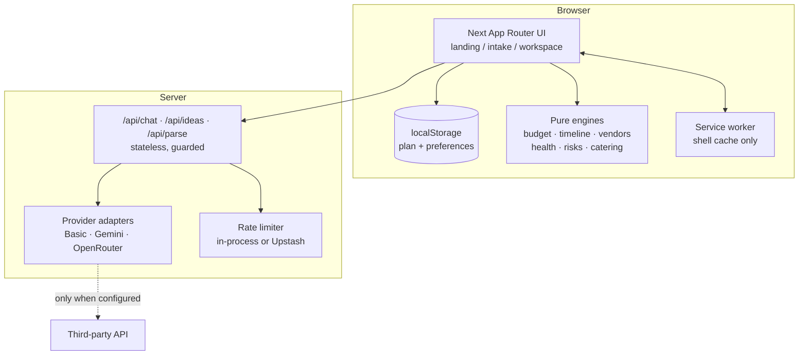
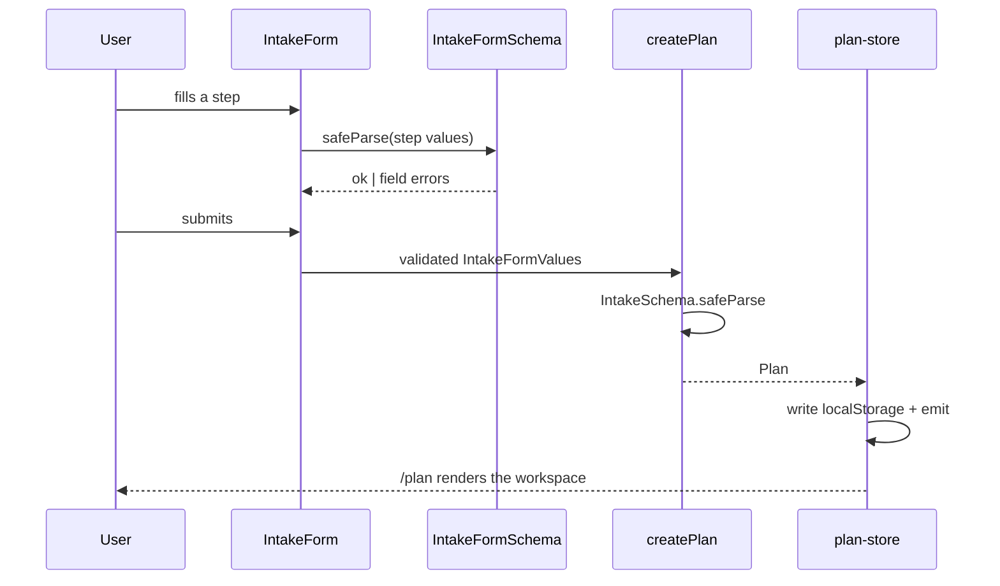
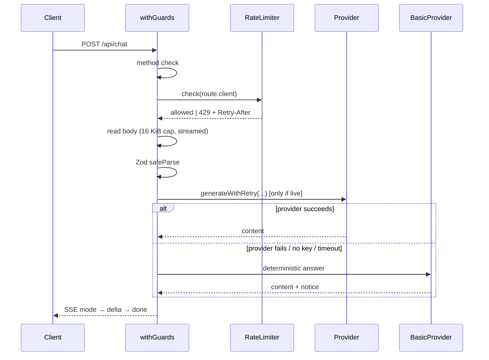

# Architecture

This document explains how Gatherly is put together, why it is put together that way, and where each
piece lives.

---

## 1. The shape of the system



Three rules explain almost everything else:

1. **The plan belongs to the browser.** There is no server-side user state.
2. **The engines are pure.** They take a plan and return a result. No network, no clock, no
   randomness.
3. **AI is optional and isolated.** Every AI call goes through one provider interface and a
   guarded route; the deterministic answer is always available as a fallback.

---

## 2. Layers

### 2.1 `src/app/` - the shell and the routes

| Route        | Rendering             | Purpose                                                      |
| ------------ | --------------------- | ------------------------------------------------------------ |
| `/`          | Server                | Landing: the product, the event families, three sample plans |
| `/intake`    | Client                | The four-step form, Zod-validated                            |
| `/plan`      | Client                | The workspace; renders the plan from `localStorage`          |
| `/api/chat`  | Node runtime, dynamic | Question and answer, SSE                                     |
| `/api/ideas` | Node runtime, dynamic | Idea generation, SSE                                         |
| `/api/parse` | Node runtime, dynamic | Free text to intake fields, JSON                             |

`src/app/layout.tsx` owns the document shell, the skip link, the header and footer, the accessibility
provider and the service-worker registrar. `src/app/globals.css` holds the design tokens, the theme
variants and the reduced-motion rules.

The API routes are `runtime = 'nodejs'` and `dynamic = 'force-dynamic'` so that they are never
prerendered or cached.

### 2.2 `src/features/` - domain slices

Each slice is a small vertical: a schema, a pure service, and (where it is a screen) a component
tree.

| Slice            | Responsibility                                                          |
| ---------------- | ----------------------------------------------------------------------- |
| `intake/`        | `IntakeFormSchema`, the step machine, the review step, the chip inputs  |
| `budget/`        | Allocation, per-guest figures, what-if scenarios, warnings              |
| `timeline/`      | Backward milestone ladder, state merging, run-of-show, `.ics` export    |
| `vendors/`       | Checklist, status, quote comparison, coverage, WhatsApp message encoder |
| `health/`        | The five-part explainable health score and the next action              |
| `catering/`      | Quantity estimates for food and drink                                   |
| `risks/`         | The risk register and its triggers                                      |
| `ideas/`         | Deterministic idea suggestions                                          |
| `assistant/`     | Intent classification and the Basic-mode answer builder                 |
| `workspace/`     | The tab shell and the six panels                                        |
| `accessibility/` | Display preferences, offline banner, service-worker registration        |

The services are pure functions over a `Plan`. That is what makes the whole planning surface
testable without a browser and usable without a network.

### 2.3 `src/lib/` - shared foundations

| Module                            | Responsibility                                                                                                   |
| --------------------------------- | ---------------------------------------------------------------------------------------------------------------- |
| `plan.ts`                         | The vocabulary (event types, currencies, categories, packs), the Zod schemas, `createPlan`, the sample templates |
| `plan-store.ts`                   | The browser store: an external store over `localStorage`                                                         |
| `plan-view.ts`                    | The single projection from a plan to everything the UI needs                                                     |
| `money.ts`                        | Integer minor units, per-currency formatting                                                                     |
| `dates.ts`                        | ISO date-only helpers                                                                                            |
| `share.ts`                        | Share-fragment encode/decode                                                                                     |
| `csv.ts`, `ics.ts`, `download.ts` | Exports                                                                                                          |
| `ai/`                             | `Provider` interface, `BasicProvider`, `GeminiProvider`, `OpenRouterProvider`, prompts                           |
| `security/`                       | Route guards, rate limiting, sanitising                                                                          |
| `i18n/`                           | `en`, `hi`, `bn` dictionaries                                                                                    |
| `api-schema.ts`                   | The schemas the API routes accept and return                                                                     |

`plan.ts` imports nothing from `src/features`, so feature services can depend on the vocabulary
without creating a cycle.

---

## 3. Data flow

### 3.1 Creating a plan



The intake form schema is deliberately slightly wider than the stored `Intake`: the budget is typed
in major units and the date may be left unset. Both are converted when the plan is built, and the
plan itself is validated again by `PlanSchema` before it is stored.

### 3.2 The plan store

The store is a **small external store**, not a React context:

```ts
usePlan(); // useSyncExternalStore(subscribe, getSnapshot, getServerSnapshot)
updatePlan(fn); // immutable update, stamps updatedAt, writes storage, notifies
hydratePlan(); // reads storage once, notifies subscribers
```

Using `useSyncExternalStore` means a change to one vendor row does not re-render the whole
workspace, and the server snapshot is `null`, so there is no hydration mismatch.

Hydration is the subtle part: React has already subscribed by the time the effect runs, so
`hydratePlan()` notifies the subscribers itself. Without that `emit()`, a page reload would show
"no plan" even though the plan was sitting in `localStorage`. This is covered by
`tests/components/plan-restore.test.tsx` and `tests/plan-store.test.ts`.

`localStorage` is treated as untrusted input: the value is parsed with `PlanSchema` on read and
discarded if it does not match.

### 3.3 The projection

`src/lib/plan-view.ts` turns a `Plan` into one object containing the budget summary, the milestone
ladder, the vendor coverage, the health report, the risks, the run-of-show and the catering
estimates. Every panel reads from that projection, so two panels can never disagree about the same
number.

### 3.4 The AI routes



The SSE stream emits a `mode` event first, so the UI can show which provider answered **before** the
text arrives. `done` carries the final mode and any notices ("the provider timed out, so this
answer comes from Basic mode").

---

## 4. The engines

All engines are pure and share the same conventions.

### Budget (`src/features/budget/services.ts`)

- Allocation is proportional, from a base split per city tier and venue type, adjusted by the
  user's stated priorities.
- Optional packs shift percentage points between categories (`PACKS[].budgetShift`).
- Every amount is an integer number of minor units. **No floating point is used for money**, and
  the allocation uses the largest-remainder method (`allocateByWeight`), so the parts always sum
  exactly to the total - no lost paise, and the result is stable for identical inputs.
- What-if scenarios re-run the same allocation for a different guest count.

### Timeline (`src/features/timeline/services.ts`)

- The milestone ladder is computed **backwards** from the event date, so a milestone always has a
  real date rather than a vague "six weeks before".
- A stored milestone's completion state is merged onto the computed ladder, so the dates stay
  correct while the user's ticks survive.

### Vendors (`src/features/vendors/services.ts`)

- Coverage compares the booked and quoted spend against the planned vendor allocation.
- A vendor is scored on the quote it has, the date it is needed and the lead time it needs.
- The WhatsApp message is built as a plain URL-encoded text, never as a deep link with injected
  markup.

### Health (`src/features/health/services.ts`)

- Five weighted parts - budget, timeline, vendors, tasks and guest experience - that add up to
  100 per cent.
- Each part carries the sentence describing **what was measured**, so the score is explainable
  rather than a black box.
- The formula is displayed in the UI.

### Catering (`src/features/catering/services.ts`)

- Quantity estimates for food and drink, derived from the guest count, the meal structure and the
  dietary needs that were stated.

---

## 5. Money, dates and currency

- **Money is always an integer number of minor units** and always carries its currency
  (`src/lib/money.ts`). Gatherly never converts between currencies and never uses a
  floating-point value for an amount, so a plan can never mix two currencies or lose a rounding
  error.
- Twenty ISO-4217 currencies are supported, each with its own metadata (fraction digits and symbol).
- Dates are stored as ISO date-only strings (`YYYY-MM-DD`) for event dates and as full ISO
  timestamps for records. `src/lib/dates.ts` holds the parsing and arithmetic, and rejects dates
  that do not exist.

---

## 6. AI: one interface, three implementations

```ts
interface Provider {
  readonly id: 'gemini' | 'openrouter' | 'basic';
  generate(request: GenerationRequest): Promise<GenerationResult>;
}
```

| Implementation       | Network | Deterministic | Used when                                                         |
| -------------------- | ------- | ------------- | ----------------------------------------------------------------- |
| `BasicProvider`      | No      | Yes           | Default, and the fallback for everything                          |
| `GeminiProvider`     | Yes     | No            | `GATHERLY_AI_PROVIDER=gemini` and `GEMINI_API_KEY` is set         |
| `OpenRouterProvider` | Yes     | No            | `GATHERLY_AI_PROVIDER=openrouter` and `OPENROUTER_API_KEY` is set |

The selection logic lives in `selectProvider()` (`src/lib/ai/index.ts`). It returns the provider,
whether it is live, and a notice the UI shows when the answer is _not_ from a live model.

**Basic mode never pretends to be a model.** It is a deterministic function over the plan, and the
badge in the UI always says so. The provider itself makes no outbound call, but the request still
reaches this app's own server, which computes the answer from the plan it was sent.

Prompt-injection defence is described in [`SECURITY.md`](../SECURITY.md#23-prompt-injection-awareness-srclibaipromptstssrclibsecuritysanitizets).

---

## 7. Accessibility as an architecture decision

Accessibility is not a layer applied at the end; it is in the data model.

- **Language is data.** The chosen language is part of the intake, stored in the plan, and every
  visible label comes from the dictionary (`src/lib/i18n/`). Switching language does not reload the
  page.
- **Display preferences are part of the plan settings** (`theme`, `textSize`, `calmMode`,
  `reducedMotion`), validated with Zod on read.
- **Preferences are applied to the document element** as data attributes, so CSS reacts without
  React re-rendering the tree.
- **Contrast is tested, not asserted.** `tests/accessibility/contrast.test.ts` computes the WCAG
  contrast ratio for every foreground/background pair in the light, dark and calm themes.
- **Motion is transform/opacity only**, and is disabled under `prefers-reduced-motion` and Calm mode.

---

## 8. Offline

`public/sw.js` caches the app shell (`/`, `/intake`, `/plan`, the manifest and the icon) and the
static assets. It **never caches `/api/*`**. The plan itself lives in `localStorage`, so with the
network switched off:

- the plan still loads and still renders,
- every engine still calculates,
- every export still works,
- the assistant answers in Basic mode with a visible notice.

---

## 9. Design system

| Token group  | Values                 |
| ------------ | ---------------------- |
| Paper        | `#FBF6EE`              |
| Ink          | `#1F1A17`              |
| Marigold     | `#E8962A`              |
| Peacock teal | `#0F6E6A`              |
| Rose         | `#B4234F`              |
| Dark mode    | `#17120F` on `#F6EFE4` |

Typography is Fraunces for display headings and Plus Jakarta Sans for body and controls, with
Noto Sans Devanagari and Bengali for the optional languages. The signature elements are the
hand-drawn garland line, the health ring and the marigold "celebration dot" status marker. Motion
is transform/opacity only, short and spring-like, and is switched off under reduced motion or Calm
mode.

`tailwind.config.ts` exposes the tokens as CSS custom properties, which is what lets the theme
variants and the contrast tests operate on a single source of truth.

---

## 10. Testing strategy

| Layer            | Tool                     | What it covers                                                                                         |
| ---------------- | ------------------------ | ------------------------------------------------------------------------------------------------------ |
| Services         | Vitest                   | The engines, money, dates, budgets, timelines, vendors, health, risks, catering, CSV, ICS, share, i18n |
| Components       | Vitest + Testing Library | Landing, intake, workspace, panels, restore, vendors, accessibility controls, exports                  |
| API and security | Vitest                   | Strict validation, body caps, rate limiting, retry, timeout, logging, adapters, sanitising             |
| Accessibility    | Vitest                   | WCAG contrast across the light, dark and calm themes                                                   |
| End to end       | Playwright               | Landing to plan, persistence across a reload, CSV and share, keyboard-only navigation                  |

Coverage thresholds (90 / 70 / 90 / 90) are enforced by `vitest.config.mts`, so a drop below them
fails the run.

---

## 11. Deliberate non-goals

- No accounts, no database, no server-side user state.
- No payments, no uploads, no vendor marketplace.
- No automated market pricing: every money figure is an estimate from visible assumptions.
- No inference of identity, religion, community or region - the tradition and festival packs are
  applied only when the user explicitly selects them.

See [`LIMITATIONS.md`](LIMITATIONS.md) for the full list.
