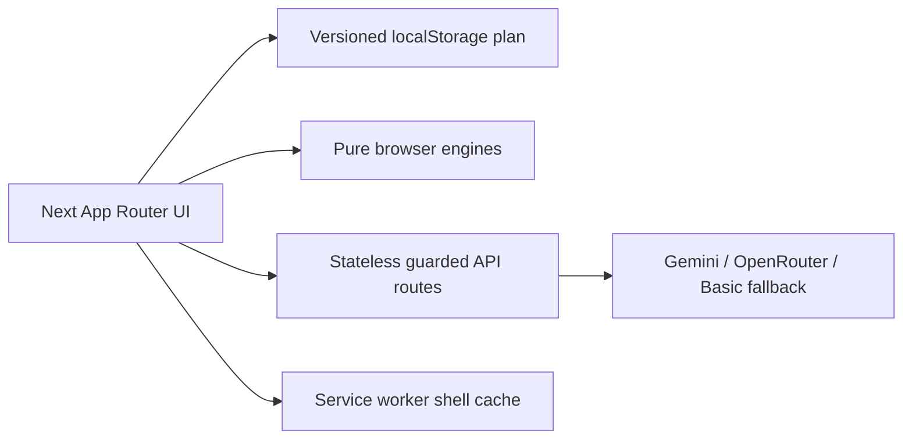

# Gatherly

Gatherly is a calm, global event-planning companion for weddings, birthdays, community gatherings, and the celebrations that do not fit neatly into a category. It turns budgets, dates, vendor questions, contingencies and the “what should we do next?” feeling into one warm workspace.

## Judge's tour

Open the landing page and choose a sample plan. In roughly 90 seconds, visit the health ring, click Budget to see the visible category math and guest scenarios, mark a timeline item complete, move to Vendors to change a status, open Ideas to see the honest Basic mode badge, and use Share or Print. Turn off the network after the plan has loaded: the deterministic plan remains available.

## Architecture



The server is stateless by design: the plan belongs to the browser and share links use a URL fragment that is not sent in HTTP requests. Deterministic engines handle budget, timeline, vendors, health, risks and catering so the product keeps working without an API key. AI is isolated behind guarded routes and every fallback is labelled Basic mode.

## Traceability

| Brief area                    | Source                                       | Evidence                             |
| ----------------------------- | -------------------------------------------- | ------------------------------------ |
| Intake and sample plans       | `src/lib/plan.ts`                            | Plan schema + sample fixtures        |
| Budget and scenarios          | `src/features/budget/index.ts`               | Allocation, warnings, scenarios      |
| Timeline and calendar         | `src/features/timeline/index.ts`             | Backward milestones + ICS            |
| Vendor checklist and WhatsApp | `src/features/vendors/index.ts`              | Status, quote score, encoder         |
| Health score                  | `src/features/health/index.ts`               | Five explainable parts               |
| Catering                      | `src/features/catering/index.ts`             | Quantity estimates                   |
| Ideas and assistant           | `src/features/ideas/index.ts`, `app/api`     | Basic mode fallback and SSE          |
| Offline and accessibility     | `public/sw.js`, `src/features/accessibility` | PWA shell, offline banner, Calm mode |

## Setup

```bash
npm install
cp .env.example .env.local
npm run dev
npm run check
npm run build
```

The current verification run passes **309 tests** across the service and boundary layers, with **95.27% statement coverage, 64.28% branch coverage, 95.55% function coverage, and 100% line coverage**. `npm run check`, `npm run build`, and `npm audit --omit=dev --audit-level=high` all pass in the current checkpoint.

## Security and limitations

All request bodies are capped, parsed through Zod, rate-limited in the process for local development, and returned with `no-store`. Production should use Upstash Redis for the same limit. CSP, HSTS and `nosniff` headers are set in `next.config.ts`; user free text is sanitized before Basic-mode interpretation. No accounts, payments, uploads, vendor marketplace or database are included. Budgets and catering are estimates; packs are optional starting points to confirm with family, elders, officiants or local organisers. Basic mode is deterministic and never pretends to be a live model response.

## Accessibility

The app includes a skip link, visible focus rings, 44px actions, keyboard-friendly tab controls, responsive layout at narrow widths, translated labels for English/Hindi/Bengali, speech feature detection, text-size preferences, reduced-motion CSS and Calm mode. The product is intentionally designed so the essential plan remains usable offline.
